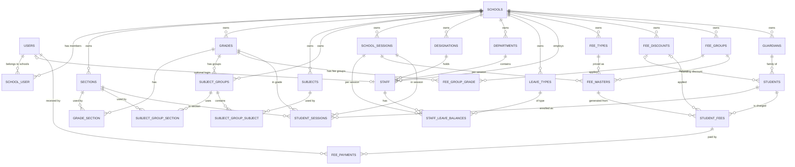

# School Management App: Final Database Structure and Working Prompt

Stack: Laravel 13 (REST API, Sanctum tokens, Pest) + React 19 (Vite, Vitest) + MySQL 8.
Document date: 2026-11-11.

This file has two parts:

1. **The finalized, polished database structure** (what is built, what is planned, and every rule that goes with it).
2. **An updated prompt** you can paste into a new chat (or another tool) to continue the project from where it stands.

---

## 1. Status at a glance

| Slice | Scope | Status |
|---|---|---|
| 1 | Setup, health check, database connection, minimal React page | Built and tested |
| 2 | Authentication, roles, school membership, school-scoped authorization | Built and tested |
| 3 | Schools, school users, password change (API and screens) | Built and tested |
| 4a | Sections | Built and tested |
| 4b | Grades and grade-to-section assignments | Built and tested |
| 4c | Subjects | Built and tested |
| 4d | Subject groups | API built and tested; screens delivered |
| 5 | School sessions | Planned (defaults to confirm) |
| 6 | Staff: designations, departments, staff, leave types, leave balances | Planned |
| 7 | Fee setup | Planned |
| 8 | Guardians and students | Planned |
| 9 | Student session enrollment | Planned |
| 10 | Student fees, payments, receipts | Planned |
| 11 | Search, pagination, dashboard summaries, reports | Planned |

Test counts at the last confirmed runs: **268 backend tests** passing (through Slice 4d API) and **241 frontend tests** passing (through Slice 4c). The Slice 4d screens add 26 frontend tests, so the expected frontend total is **267**; confirm it when you run them.

---

## 2. Design principles and conventions

**Tenancy.** One database, many schools. Every school-owned table has a `school_id`, and every request for school data is checked against the user's membership and role at that school.

**Naming.**
- Tables are plural snake_case (`fee_types`). Pivot tables are singular, alphabetical, and have a composite primary key instead of an `id` (`grade_section`).
- Exception: `subject_group_section` and `subject_group_subject` keep the names from the original requirements.
- Foreign keys are `<singular>_id`. Enum values are lowercase (`active`, `theory`).

**Keys and deletion.**
- Parents are protected with `restrictOnDelete`. Pivot rows whose owner is deleted use `cascadeOnDelete`.
- Soft deletes (`deleted_at`) only where history matters and there is no other way to retire a record: schools now, and students, staff, and guardians later.
- Everything else is retired by setting `status` to `inactive`, and can be deleted only when nothing uses it.

**Money.** `decimal(12,2)`, never floats. Amounts are never edited after the fact: corrections are new rows.

**Timestamps.** `created_at` and `updated_at` on every table except pure pivots.

**Enums.** A PHP backed enum in the application and, where the value list is small and fixed, a database `enum` (or check constraint) as a second line of defence.

**Mass assignment.** `school_id`, `is_super_admin`, and slugs are never fillable. They are set by server code from the URL or the authenticated user.

**Cross-school safety.** Layered:
1. Nested routes (`/schools/{school}/…`) with scoped route binding, so another school's id returns 404.
2. Validation rules that restrict submitted ids to the same school (and, for sections in a subject group, to the group's grade).
3. Policies on every route, with super admins passing through `Gate::before`.
4. Optional database hardening before production: composite foreign keys such as `(school_id, id)`.

---

## 3. Entity relationship overview



---

## 4. Tables that are built (Slices 1 to 4)

### 4.1 `users`

| Column | Type | Null | Notes |
|---|---|---|---|
| id | bigint unsigned, PK | no | |
| name | varchar(255) | no | |
| email | varchar(255) | no | **unique**; lowercased when an account is created through the API |
| email_verified_at | timestamp | yes | |
| password | varchar(255) | no | hashed, minimum 10 characters when set through the API |
| is_super_admin | boolean | no | default `false`; never mass-assignable |
| remember_token | varchar(100) | yes | |
| created_at, updated_at | timestamp | yes | |

Replaces the original `user_type`. Authorization uses `is_super_admin` plus the per-school role in `school_user`.

Framework tables also exist and are not part of the domain model: `personal_access_tokens` (Sanctum; tokens expire after 8 hours), `password_reset_tokens`, `sessions`, `cache`, `cache_locks`, `jobs`, `job_batches`, `failed_jobs`, `migrations`.

### 4.2 `schools`

| Column | Type | Null | Notes |
|---|---|---|---|
| id | bigint unsigned, PK | no | |
| name | varchar(255) | no | |
| slug | varchar(255) | no | **unique** (including soft-deleted rows); generated from the name, never changed afterwards |
| status | varchar(255) | no | default `active`; values `active`, `inactive` (a label for now; does not block access) |
| url | varchar(255) | yes | http or https only |
| phone | varchar(30) | yes | |
| email | varchar(255) | yes | |
| address | text | yes | |
| about | text | yes | |
| created_at, updated_at | timestamp | yes | |
| deleted_at | timestamp | yes | soft delete; only super admins delete |

### 4.3 `school_user` (membership and role)

| Column | Type | Null | Notes |
|---|---|---|---|
| school_id | FK to schools | no | cascade on delete |
| user_id | FK to users | no | cascade on delete |
| role | enum(`admin`, `teacher`) | no | |
| created_at, updated_at | timestamp | yes | |

Primary key `(school_id, user_id)`, so one role per person per school. Index on `user_id`. The same person can be admin at one school and teacher at another.

### 4.4 `sections`

| Column | Type | Null | Notes |
|---|---|---|---|
| id | bigint unsigned, PK | no | |
| school_id | FK to schools | no | restrict |
| title | varchar(100) | no | trimmed |
| status | varchar(255) | no | default `active`; `active` or `inactive` |
| created_at, updated_at | timestamp | yes | |

Unique `(school_id, title)`.

### 4.5 `grades`

Same columns and rules as `sections`: `school_id`, `title varchar(100)`, `status`, timestamps. Unique `(school_id, title)`.

### 4.6 `grade_section`

| Column | Type | Null | Notes |
|---|---|---|---|
| grade_id | FK to grades | no | **cascade** on delete |
| section_id | FK to sections | no | **restrict** on delete |

Primary key `(grade_id, section_id)`, index on `section_id`. A section can belong to many grades.

### 4.7 `subjects`

| Column | Type | Null | Notes |
|---|---|---|---|
| id | bigint unsigned, PK | no | |
| school_id | FK to schools | no | restrict |
| title | varchar(150) | no | **not unique**: a theory and a practical "Mathematics" may coexist |
| code | varchar(30) | no | stored **uppercase**; pattern `^[A-Z0-9][A-Z0-9._-]*$` |
| type | enum(`theory`, `practical`) | no | replaces the duplicate `type` and `subject_type` columns |
| status | varchar(255) | no | default `active` |
| created_at, updated_at | timestamp | yes | |

Unique `(school_id, code)`.

### 4.8 `subject_groups`

| Column | Type | Null | Notes |
|---|---|---|---|
| id | bigint unsigned, PK | no | |
| school_id | FK to schools | no | restrict |
| grade_id | FK to grades | no | restrict; **fixed after creation** |
| title | varchar(150) | no | |
| description | text | yes | |
| created_at, updated_at | timestamp | yes | |

Unique `(school_id, grade_id, title)`.

### 4.9 `subject_group_section`

`subject_group_id` (FK, cascade) and `section_id` (FK, restrict). Primary key `(subject_group_id, section_id)`, index on `section_id`.
Rule: the section must be one of the group's grade's sections (a row in `grade_section`).

### 4.10 `subject_group_subject`

`subject_group_id` (FK, cascade) and `subject_id` (FK, restrict). Primary key `(subject_group_id, subject_id)`, index on `subject_id`. The subject must belong to the same school.

---

## 5. Tables that are planned (Slices 5 to 11)

These apply the schema-review decisions you approved: school-scoped lookups, decimal money, immutable payment rows, and roll numbers on enrollments. Items marked **(confirm)** are defaults I will restate and ask about at the start of that slice.

### 5.1 `school_sessions` (Slice 5)

| Column | Type | Null | Notes |
|---|---|---|---|
| id | PK | no | |
| school_id | FK to schools | no | restrict |
| title | varchar(100) | no | e.g. "2026-2027" |
| starts_on | date | no | **(confirm)** |
| ends_on | date | no | **(confirm)**; check `ends_on > starts_on` |
| is_current | boolean | no | default false |
| current_marker | bigint unsigned | yes | equals `school_id` while current, otherwise NULL; **unique**, so the database itself allows at most one current session per school |
| status | varchar(255) | no | default `active` |
| created_at, updated_at | timestamp | yes | |

Unique `(school_id, title)`. Rule **(confirm)**: exactly one current session per school, switched inside a transaction. Sessions may not overlap **(confirm)**.

### 5.2 Staff lookups (Slice 6)

`designations`, `departments`, `leave_types`: each has `id`, `school_id` (FK, restrict), `title varchar(100)`, timestamps. Unique `(school_id, title)`. Changed from global to **school-scoped**, so one school's edits never affect another.

### 5.3 `staff` (Slice 6)

| Column | Type | Null | Notes |
|---|---|---|---|
| id | PK | no | |
| school_id | FK to schools | no | restrict |
| user_id | FK to users | yes | optional link to a login account; unique when set **(confirm)** |
| designation_id | FK to designations | no | restrict; same school |
| department_id | FK to departments | no | restrict; same school |
| staff_no | varchar(30) | no | unique per school |
| first_name, last_name | varchar(100) | no | |
| father_name, mother_name | varchar(150) | yes | |
| gender | enum(`male`, `female`) | no | **(confirm** whether to add `other`) |
| marital_status | enum(`single`, `married`, `divorced`, `widowed`) | yes | **(confirm)** |
| birth_date, joining_date | date | no | |
| email | varchar(255) | yes | unique per school when set |
| phone, emergency_contact_number | varchar(30) | yes | |
| cnic | char(13) | yes | digits only; unique per school when set |
| photo_path | varchar(255) | yes | private disk, served through an authorized route |
| address | text | yes | |
| qualification, work_experience | text | yes | |
| basic_salary | decimal(12,2) | no | check `>= 0` |
| bank_account_title, bank_name, bank_branch_name | varchar(150) | yes | |
| bank_account_number | text | yes | **encrypted at rest** |
| status | varchar(255) | no | default `active` |
| created_at, updated_at, deleted_at | timestamp | yes | soft delete |

Unique `(school_id, staff_no)`, `(school_id, cnic)`, `(school_id, email)` (NULLs allowed).

### 5.4 `staff_leave_balances` (Slice 6)

Replaces `staff_leaves`.

| Column | Type | Null | Notes |
|---|---|---|---|
| id | PK | no | |
| staff_id | FK to staff | no | cascade |
| leave_type_id | FK to leave_types | no | restrict |
| school_session_id | FK to school_sessions | no | restrict |
| allocated | decimal(5,1) | no | days; check `>= 0` |
| used | decimal(5,1) | no | default 0; check `>= 0` |
| created_at, updated_at | timestamp | yes | |

Unique `(staff_id, leave_type_id, school_session_id)`. Individual leave requests are out of scope for now.

### 5.5 Fee setup (Slice 7)

**`fee_types`**: `id`, `school_id`, `title`, `description` (nullable), timestamps. Unique `(school_id, title)`.

**`fee_discounts`**: `id`, `school_id`, `title`, `discount_type` enum(`percentage`, `fixed`), `value decimal(10,2)`, `description`, timestamps. Checks: `value >= 0`, and `value <= 100` when `percentage`. Unique `(school_id, title)`. Replaces the ambiguous "amount or percentage" column.

**`fee_groups`**: `id`, `school_id`, `title`, `description`, `allows_discount` boolean default true (renamed from `is_discount_apply`), timestamps. Unique `(school_id, title)`.

**`fee_group_grade`**: `fee_group_id` (cascade), `grade_id` (restrict). Primary key `(fee_group_id, grade_id)`.

**`fee_masters`**: the price list.

| Column | Type | Notes |
|---|---|---|
| id | PK | |
| school_id | FK | |
| school_session_id | FK, restrict | |
| fee_group_id | FK, restrict | |
| fee_type_id | FK, restrict | |
| due_date | date | |
| amount | decimal(12,2) | check `>= 0` |
| fine_type | enum(`none`, `fixed`, `percentage`) | **(confirm)**; replaces the vague `late_fee` and `other` |
| fine_value | decimal(10,2) | default 0 |
| created_at, updated_at | timestamp | |

Unique `(fee_group_id, fee_type_id, school_session_id)`. All four references must belong to the same school.

### 5.6 Guardians and students (Slice 8)

**`guardians`**: one record per **family**, shared by siblings **(confirm)**.

| Column | Type | Null |
|---|---|---|
| id, school_id | PK, FK | no |
| father_name, father_phone, father_occupation, father_cnic | varchar | yes |
| mother_name, mother_phone, mother_occupation, mother_cnic | varchar | yes |
| is_guardian_other | boolean, default false | no |
| guardian_name, guardian_relation, guardian_email, guardian_phone, guardian_occupation, guardian_cnic | varchar | yes |
| guardian_address | text | yes |
| created_at, updated_at, deleted_at | timestamp | soft delete |

Rule: at least one contact phone is required, and the guardian fields are required when `is_guardian_other` is true. CNIC values are indexed but not unique (siblings share the family record).

**`students`**

| Column | Type | Null | Notes |
|---|---|---|---|
| id | PK | no | |
| school_id | FK | no | restrict |
| guardian_id | FK to guardians | no | restrict; same school |
| fee_discount_id | FK to fee_discounts | yes | standing discount, restrict |
| admission_no | varchar(30) | no | unique per school |
| first_name, last_name | varchar(100) | no | |
| gender | enum(`male`, `female`) | no | **(confirm)** |
| religion, email, phone | varchar | yes | |
| address | text | yes | |
| photo_path | varchar(255) | yes | private disk |
| birth_date | date | no | |
| b_form_number | varchar(15) | yes | unique per school when set; split from the old `b_form_id`/`b_form` |
| b_form_document_path | varchar(255) | yes | private disk |
| admission_date | date | no | |
| leave_date | date | yes | required when status is `leave` |
| status | enum(`pending`, `active`, `leave`, `alumni`) | no | default `pending` |
| previous_school_details, note | text | yes | |
| created_at, updated_at, deleted_at | timestamp | yes | soft delete |

`roll_number` moved to `student_sessions`, because it changes every year.

### 5.7 `student_sessions` (enrollments, Slice 9)

| Column | Type | Null | Notes |
|---|---|---|---|
| id | PK | no | |
| school_id | FK | no | |
| student_id | FK to students | no | restrict |
| school_session_id | FK to school_sessions | no | restrict |
| grade_id | FK to grades | no | restrict |
| section_id | FK to sections | no | restrict |
| roll_number | varchar(20) | yes | |
| promoted_from_id | FK to student_sessions | yes | the earlier enrollment, giving promotion and transfer history |
| created_at, updated_at | timestamp | yes | |

- Unique `(student_id, school_session_id)`: one enrollment per student per session.
- Unique `(school_id, school_session_id, grade_id, section_id, roll_number)`: roll numbers are unique within a class for a session (NULLs allowed).
- Recommended hardening: a **composite foreign key** `(grade_id, section_id)` referencing `grade_section (grade_id, section_id)`, so a student can never be enrolled in a section the grade doesn't have.
- Promotion means a new row in the next session, never an edit of the old one.

### 5.8 Student fees and payments (Slice 10)

**`student_fees`**: what a student owes, generated from a fee master. A snapshot, so later price changes don't rewrite history.

| Column | Type | Notes |
|---|---|---|
| id, school_id | PK, FK | |
| student_id | FK, restrict | |
| school_session_id | FK, restrict | |
| fee_master_id | FK, restrict | |
| fee_discount_id | FK, nullable | the discount that was applied |
| due_date | date | copied at generation |
| amount | decimal(12,2) | copied at generation |
| discount_amount | decimal(12,2) | default 0 |
| fine_amount | decimal(12,2) | default 0; the fine actually applied |
| total_amount | decimal(12,2) | `amount - discount_amount + fine_amount`, never negative |
| created_at, updated_at | timestamp | |

Unique `(student_id, fee_master_id)`. The redundant copies of the group and type names are removed. **Status is derived**, not stored.

**`fee_payments`** replaces `student_fees_receives`. Rows are **immutable**.

| Column | Type | Notes |
|---|---|---|
| id, school_id | PK, FK | |
| student_fee_id | FK, restrict | |
| kind | enum(`payment`, `reversal`) | corrections are new `reversal` rows |
| reverses_payment_id | FK to fee_payments, nullable | set on reversals |
| amount | decimal(12,2) | always positive; check `> 0` |
| paid_at | datetime | |
| method | enum(`cash`, `bank_transfer`, `cheque`, `online`, `other`) | **(confirm)** |
| reference | varchar(100), nullable | cheque or transfer number |
| receipt_no | varchar(30) | unique per school |
| note | text, nullable | |
| received_by | FK to users, restrict | who took the money |
| created_at | timestamp | no `updated_at`: rows never change |

**`receipt_sequences`** (supporting): `school_id` (PK, FK) and `next_number`. The row is locked inside the payment transaction so receipt numbers are gap-free per school.

---

## 6. Integrity rules at a glance

### 6.1 Money formulas (Slice 10)

- Discount: `percentage` gives `round(amount x value / 100, 2)` (half up). `fixed` gives `min(value, amount)`.
- `total_amount = amount - discount_amount + fine_amount`.
- `paid_amount = sum(payment) - sum(reversal)`; `balance = total_amount - paid_amount`.
- Status: balance 0 means **paid**; paid amount 0 means **unpaid**; otherwise **partial**.
- A payment may not exceed the balance. Payments and reversals happen inside one database transaction.

### 6.2 Deletion behaviour

| Parent | Child | Behaviour |
|---|---|---|
| school | members, academics, students, staff, fees | blocked (`restrict`); schools are soft-deleted |
| user | school_user | child rows removed |
| grade | grade_section | child rows removed |
| grade | subject_groups | **blocked**, with a readable message |
| section | grade_section, subject_group_section | **blocked** while any grade or group uses it |
| subject | subject_group_subject | **blocked** while any group uses it |
| subject_group | its pivot rows | removed |
| anything with students, fees, or payments | | blocked; use `status` or soft delete instead |

### 6.3 Uniqueness summary

| What | Scope |
|---|---|
| user email | global |
| school slug | global, including deleted schools |
| section, grade, designation, department, leave type, fee type, fee discount, fee group, session title | per school |
| subject code | per school (uppercase) |
| subject group title | per school and grade |
| staff_no, staff cnic, staff email | per school (NULLs allowed) |
| student admission_no, b_form_number | per school (b_form_number may be NULL) |
| roll_number | per school, session, grade, and section |
| enrollment | one per student per session |
| fee master | per fee group, fee type, and session |
| student fee | per student and fee master |
| receipt_no | per school |

### 6.4 Enumerations

| Where | Values |
|---|---|
| school_user.role | admin, teacher |
| schools.status, sections.status, grades.status, subjects.status, staff.status | active, inactive |
| subjects.type | theory, practical |
| fee_discounts.discount_type | percentage, fixed |
| fee_masters.fine_type | none, fixed, percentage |
| students.status | pending, active, leave, alumni |
| fee_payments.kind | payment, reversal |
| fee_payments.method | cash, bank_transfer, cheque, online, other |
| gender | male, female (confirm whether to add other) |

### 6.5 Sensitive data

CNIC, B-Form numbers, bank details, salary, phone numbers, addresses, and photos are personal data.
- Never write them to logs, exception messages, or test output (tests use fake factory data).
- Keep them out of API responses unless the viewer's role needs them.
- Encrypt bank account numbers at rest.
- Store photos and documents on a private disk and serve them through an authorized route.

---

## 7. Business rules already enforced (and tested)

**Access**
1. A user is a super admin or has a role per school (admin or teacher). Super admins may do anything everywhere.
2. Teachers can read their school's data; only that school's admins (or super admins) change it.
3. Only super admins create or delete schools, change a school's status, and attach an existing account to a school.
4. A school must always keep at least one admin (blocked on demotion and removal).
5. Wrong-school access returns 403 on the school itself and 404 for records inside another school.

**Accounts**
6. Passwords are at least 10 characters, hashed, and changing one requires the current password, signs out other devices, and is rate-limited.
7. Login is rate-limited (5 per minute per email and IP) and tokens expire after 8 hours.
8. Accounts created through the API can never be super admins.

**Academics**
9. Titles are unique per school; subject codes are uppercase and unique per school; subject titles may repeat.
10. Grades choose their sections from the same school only.
11. A section cannot be deleted while a grade uses it.
12. A subject group belongs to one grade and cannot change grade; its sections must be sections of that grade; its subjects must belong to the school.
13. A section cannot be removed from a grade while one of that grade's subject groups uses it, and the whole save is undone if it fails.
14. A subject in use by a group, and a grade that has groups, cannot be deleted.

---

## 8. What changed from the original requirements

| Original | Final | Why |
|---|---|---|
| `users.user_type` | `users.is_super_admin` plus `school_user.role` | One person can have different roles at different schools |
| `school_user.id` | composite primary key plus `role` | No duplicate memberships |
| global `designations`, `departments`, `leave_types` | school-scoped | Schools edit their own lists |
| `subjects.type` and `subject_type` | single `type` enum | The two columns overlapped |
| `subjects.code` unique per school | same, stored uppercase | Case-insensitive uniqueness on every database |
| `subject_groups` (no uniqueness) | unique per grade, grade fixed, description kept | Prevents duplicates and inconsistent re-parenting |
| pivots with an `id` | composite primary keys | Prevents duplicates, smaller and faster |
| `school_sessions` (title, status) | plus dates, `is_current`, one-current guarantee | Time-based rules need dates |
| `staff_leaves.total` | `staff_leave_balances` with allocated, used, per session | Balances reset each year |
| `staff` (money as numbers) | `decimal(12,2)`, encrypted bank number, optional user link | Correct money, protected data |
| `fees_*` | `fee_*` naming | Laravel conventions |
| `fees_discounts` "amount or percentage" | `discount_type` plus `value` with checks | Removes the ambiguity |
| `fees_groups.is_discount_apply` | `allows_discount` | Clearer name |
| `fees_masters` | plus fine rule (`fine_type`, `fine_value`) | The rule belongs on the price list |
| `student_fees` copies of names and ids | ids only plus amount snapshots | Removes duplicated data |
| `student_fees.status` | derived from payments | No stale status |
| `student_fees_receives` | `fee_payments`, immutable, with reversals and receipt numbers | Audit trail and partial payments |
| `students.roll_number` | moved to `student_sessions` | It changes every year |
| `students.b_form_id`, `b_form` | `b_form_number`, `b_form_document_path` | One was a number, one a file |
| `students.fees_discount_id` | `fee_discount_id` | Naming |

---

## 9. Open decisions to confirm before the slice that needs them

1. **Sessions (Slice 5):** exactly one current session per school? Start and end dates required? May sessions overlap? (Defaults: yes, yes, no.)
2. **Gender and marital status values:** keep male and female only? Which marital values?
3. **Fines (Slice 7):** `none`, `fixed`, `percentage`, applied by an admin action or by a scheduled command?
4. **Guardians (Slice 8):** one family record shared by siblings, or a many-to-many link? (Default: shared record.)
5. **Roll numbers (Slice 9):** unique per session, grade, and section? (Default: yes.)
6. **Receipts (Slice 10):** one number series per school, or per school and session? Payment methods list?
7. **Staff login (Slice 6):** link staff to user accounts, and is it required for teachers?
8. **Promotion (Slice 9):** is a bulk "promote a whole class" action in scope?
9. **Forgot password:** needs email sending and reset tokens. Treat it as its own slice.
10. **Production hardening:** add composite foreign keys for cross-school integrity, restrict CORS to the real frontend address, and move tokens out of browser storage (for example to cookie-based Sanctum).

---

## 10. Updated prompt

Paste everything inside the block below into a new conversation. Attach this file too, so the schema in sections 4 to 6 is available.

```text
You are my senior Laravel and React mentor. We are building a multi-school management application together. It is partly built; continue it from the current state below, feature by feature, test by test.

## Current state

Stack: Laravel 13 (REST API, Sanctum bearer tokens, Pest, MySQL 8, PHP 8.4) in backend/, and a separate React 19 app (Vite, React Router 7, axios, Vitest, Testing Library) in frontend/, in one git repository.

Built and tested: project setup and health check; authentication with 8-hour tokens and login throttling; super admin plus per-school roles (admin, teacher); schools CRUD; school members (add, change role, remove, attach existing account for super admins, last-admin guard); change password; sections; grades with section assignments; subjects; subject groups (API tested, screens delivered). Last confirmed totals: 268 backend tests, 241 frontend tests (expect 267 after the subject group screens).

The finalized database structure, rules, and open decisions are in the attached document (sections 4 to 9). Treat it as the source of truth. If something in the code and the document disagree, tell me before changing either.

## How we work

1. Present the plan and the schema defaults for a slice first, flag any real business decision, and wait for my confirmation before coding.
2. Build each slice backend first, then frontend, in sub-steps small enough to verify. For each sub-step:
   - explain the concepts in plain language first (I am new to React);
   - give complete file contents (whole-file replacements, including full migration files), never fragments that can be mis-pasted;
   - add focused tests alongside the code, and state the exact test count I should see;
   - give the exact commands to run and what a pass proves and does NOT prove;
   - give a short manual check (curl for the API, browser steps for screens, including keyboard use);
   - give the git commit command, then a progress checklist.
3. When I paste test output, compare it to the expected count, explain every failure from the evidence, and fix it. Do not move on past a failure. Do not guess at files you have not seen; ask me to paste them.
4. Do not silently make irreversible business-rule assumptions. Offer a default, explain its impact, and ask.

## Conventions to keep

Backend
- Nested, school-scoped routes: Route::apiResource('schools.xxx', Controller::class)->scoped(); controllers declare permissions with HasMiddleware (can:view,school for reads, can:manage,school for writes).
- school_id is never fillable; records are created through the school relation. Form Requests validate; submitted ids are restricted to the same school.
- Policies plus Gate::before for super admins. Friendly 422 messages for "in use" deletions, with restrictOnDelete foreign keys as the backstop.
- Backed enums for fixed value lists; decimal for money; transactions for multi-step writes.
- Migrations are history: never edit one that has run; roll back (development only) or add a new migration.
- Pest tests with uniquely named helper functions per file (Pest loads all files in one process); migrate:fresh --seed keeps demo data (super@school.test, admin@school.test, teacher@school.test, password "password", local environment only).

Frontend
- Shared pieces already exist and must be reused: createResourceApi (src/lib/resourceApi.js), useCrudPage (list, one add/edit form, delete with confirmation), useApiForm (saving state and server errors), TextField, CheckboxGroup, ConfirmPanel, the permission helper functions in src/lib/permissions.js, AuthContext with refreshUser.
- Accessibility: every control has a label; errors are linked with aria-describedby; focus moves deliberately (to the first field after adding, to the heading after saving or deleting, back to the trigger on cancel); repeated buttons have specific accessible names.
- Pages read their config from a module-level constant (the hook's effect depends on it). Keep lint clean (npm run lint) and the build passing.

Security and privacy
- Validate every request, authorize school-scoped access, hash passwords, prevent cross-school leaks, never log personal or bank data, keep sensitive fields out of API responses unless the role needs them.

## What is left to deliver (in this order, adjusting if dependencies require)

5. School sessions.
6. Staff: designations, departments, staff, leave types, leave balances.
7. Fee setup: fee types, discounts, groups, group-grade assignments, fee masters.
8. Guardians and students.
9. Student session enrollment.
10. Student fee generation, payments with reversals and receipts, payment history.
11. Search, pagination, dashboard summaries, and any agreed reporting.
Also pending: a forgot-password flow, and the production hardening items in section 9 of the document.

## Testing expectations

Use Laravel feature tests for API behaviour, validation, authorization, school isolation, relationships, and fee calculations. Use Vitest and Testing Library for key forms, pages, and user-visible states. Tests go in with each slice, not at the end. After each run tell me the exact command, which tests passed or failed, and what the result proves and does not prove.

## Start here

Begin with Slice 5 (school sessions): confirm the repository state with me (git status and the last test counts), then present the plan and the defaults for the open session decisions in section 9 of the document, and wait for my answer before writing any code.
```
